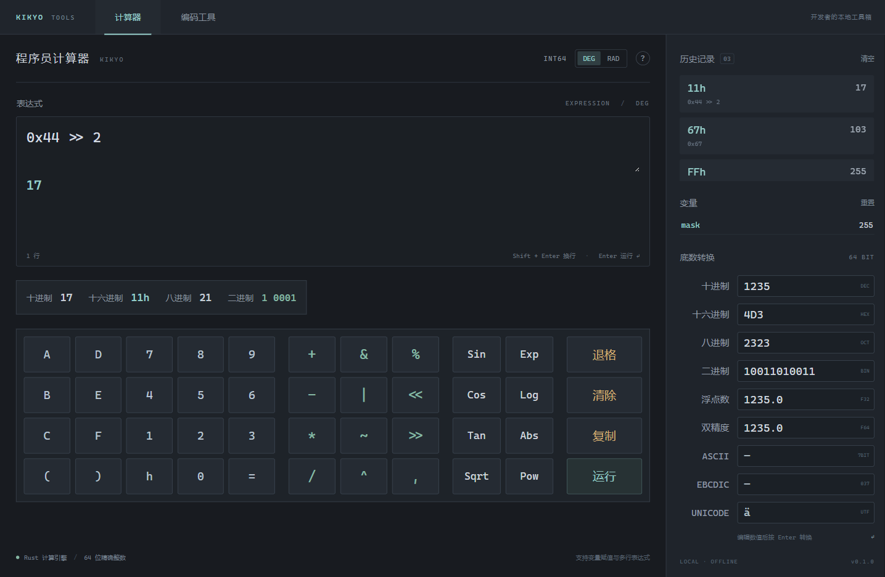
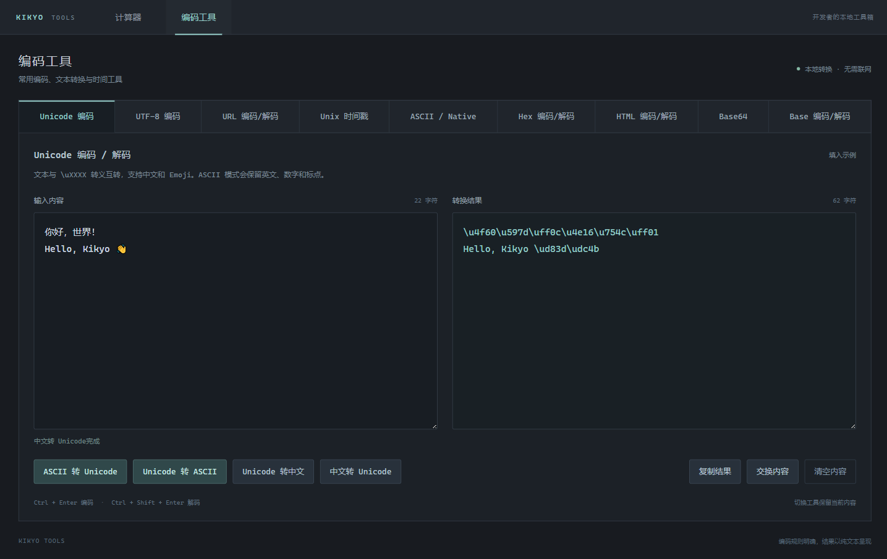
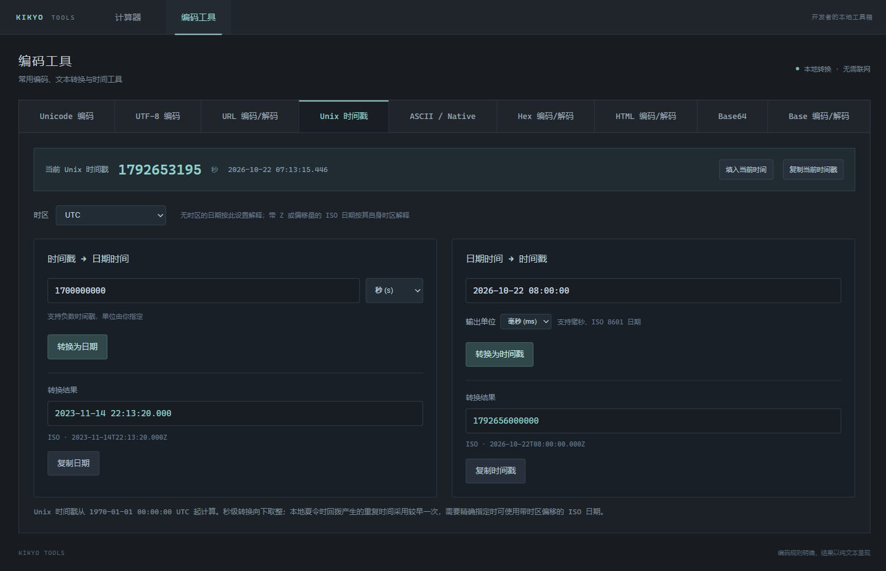
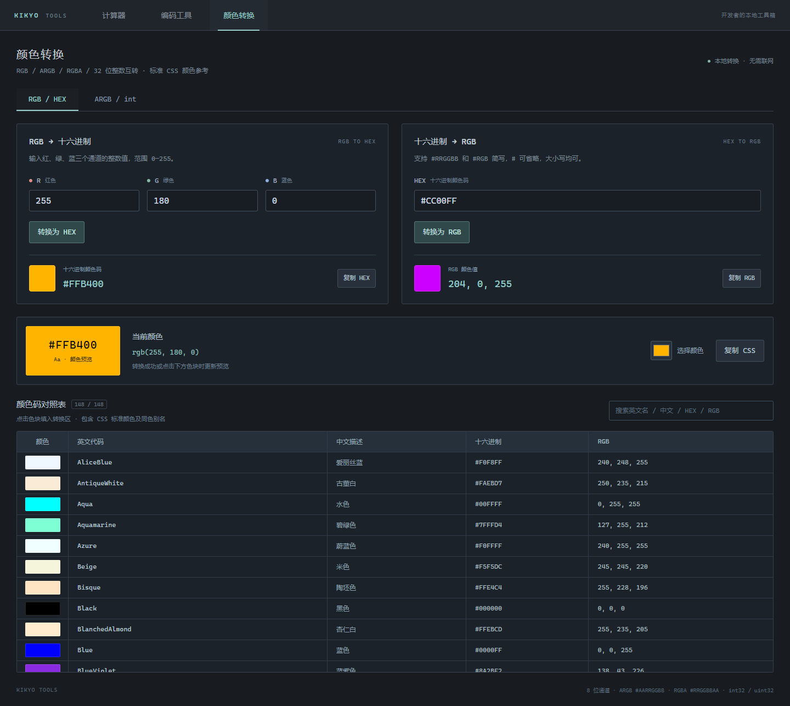
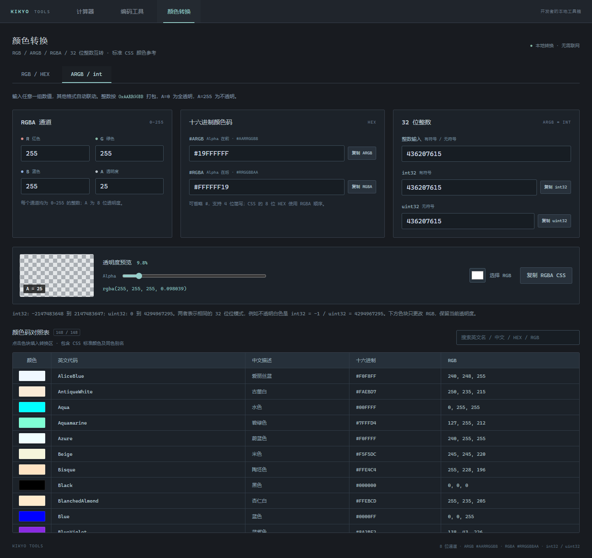

# Kikyo · 开发工具

基于 **Tauri 2 + Vue 3 + TypeScript + Rust** 的本地工具箱，包含可切换的“计算器”“编码工具”和“颜色转换”三个页面。界面采用深色主题，页面切换保留各自输入。Rust 负责计算器的表达式运算，编码和时间转换在本地浏览器环境完成，均不需要联网。

## 界面预览

以下截图来自实际运行的应用界面。

### 程序员计算器

支持表达式、位运算、历史记录、变量和多进制转换。



### 编码工具

Unicode、UTF-8、URL、ASCII / Native、Hex、HTML、Base64 等工具通过分类 Tab 切换。



### Unix 时间戳

支持时间戳和日期双向转换，以及秒/毫秒、本地时区/UTC 切换。



### 颜色转换

RGB 与 HEX 双向转换、ARGB/RGBA 与 32 位整数互转、透明度预览、取色器，以及可搜索的 CSS 命名颜色表。



#### ARGB ↔ int 与透明度



## 功能

- 算术运算、64 位整数位运算和科学函数。
- 十进制、十六进制、八进制、二进制输入与转换。
- 多行表达式、变量赋值、上一条结果 `ans`。
- DEG / RAD 角度模式切换。
- Float32 / Float64 数值转换，ASCII、Unicode 及 EBCDIC IBM037 字符显示。
- 主结果区只显示数值；各进制表示独立显示在下方结果栏和右侧转换栏。
- 历史回填、变量点击插入、结果复制、键盘快捷键。
- 历史记录、变量和角度模式保存在本地，历史最多保留 100 条。

## 编码工具

顶部选择“编码工具”，再切换分类。每个分类分别保留输入、结果和错误信息；左侧输入内容，右侧显示纯文本结果，支持复制、交换和清空。编码内容仅保存在当前窗口内存中，关闭应用后清除。

| 工具 | 功能与格式 |
| --- | --- |
| Unicode 编码 | 文本与 `\uXXXX` / `\u{...}` 转义互转，支持中文和 Emoji；“中文转 Unicode”保留 ASCII 字符 |
| UTF-8 编码 | UTF-8 字节转十六进制，如 `中` → `E4 B8 AD`；解码支持空格、`0x` 和 `\x` 格式 |
| URL 编码/解码 | URL 参数、完整 URL、表单三种模式；表单模式用 `+` 表示空格 |
| Unix 时间戳 | 时间戳与日期双向转换，秒/毫秒、本地时间/UTC、当前时间、ISO 8601 带时区日期 |
| ASCII / Native | 类似 `native2ascii`：仅将非 ASCII 字符转为 Unicode 转义，反向恢复文本 |
| Hex 编码/解码 | UTF-8 文本与连续十六进制字节互转 |
| HTML 编码/解码 | HTML 特殊字符转义及命名/数字实体解码，结果不作为 HTML 执行 |
| Base64 | UTF-8 文本的标准或 URL 安全 Base64 编码与解码 |
| Base 编码/解码 | Base16、RFC 4648 Base32、Bitcoin 字符集 Base58 |

文本框中 `Ctrl+Enter` 编码，`Ctrl+Shift+Enter` 解码。二进制解码使用严格 UTF-8，非法字节或无效转义会显示错误。Base58 为避免大文本转换阻塞窗口，输入有单独的长度限制。

时间戳单位需要明确选择；无时区日期按选择的本地时区或 UTC 解释，ISO 日期的 `Z` / 时区偏移优先。无效日期（如 2 月 30 日）会报错。秒级输出向下取整，本地夏令时重复时段采用较早一次；需要消除歧义时输入带偏移的 ISO 日期。

## 颜色转换

顶部选择“颜色转换”，页面内提供 **RGB / HEX** 和 **ARGB / int** 两种模式。

### RGB / HEX

- **RGB → HEX**：三个通道均为 `0..255` 的整数，例如 `255, 180, 0` → `#FFB400`。
- **HEX → RGB**：支持 `#RRGGBB` 和 `#RGB`，可省略 `#`，不区分大小写。例如 `#CC00FF` → `204, 0, 255`，`#F80` → `255, 136, 0`。
- 转换结果使用规范的大写 HEX，支持复制 HEX、RGB 及 CSS `rgb(...)`。

### ARGB / int

编辑 RGBA 通道、ARGB、RGBA 或十进制整数时，其他格式自动联动：

| 格式 | 规则 |
| --- | --- |
| A / R / G / B | 每个通道为 `0..255` 的整数；A=0 全透明，A=255 不透明 |
| ARGB | `#AARRGGBB`，Alpha 在前，支持 `#ARGB` 四位简写 |
| RGBA | `#RRGGBBAA`，Alpha 在后，支持 `#RGBA` 四位简写；这是 CSS 八位 HEX 的顺序 |
| int32 | 有符号 32 位整数，范围 `-2147483648..2147483647` |
| uint32 | 无符号 32 位整数，范围 `0..4294967295` |

整数统一按 `0xAARRGGBB` 打包，计算式为 `A × 16777216 + R × 65536 + G × 256 + B`。int32 与 uint32 表示同一组 32 位位模式。HEX 及整数都是标准化结果，不对 RGB 做预乘 Alpha。

示例：`A=25, R=G=B=255` → ARGB `#19FFFFFF`、RGBA `#FFFFFF19`、整数 `436207615`；不透明白色为 int32 `-1` / uint32 `4294967295`。

提供棋盘格透明预览、Alpha 滑块和取色器，可复制两种 HEX、有符号/无符号整数及 CSS `rgba(...)`。Alpha 的 CSS 小数显示保留最多六位；整数和 HEX 保留精确的八位通道值。输入不完整或无效时显示错误，其他字段及预览保留最近有效值。

### 颜色对照表

- 对照表包含 **148 个 CSS 标准命名颜色**，支持英文名、中文描述、HEX 和 RGB 搜索，保留 Aqua/Cyan、Gray/Grey 等同色别名。
- 取色器及对照表色块会填入颜色。ARGB 模式下更改 RGB 时保留最近有效的 Alpha。
- 无效通道、小数、越界整数等输入会显示错误，不会自动截断或取整。切换模式和 Tab 均保留输入和结果。

交互参考 [RGB 与十六进制颜色转换工具](https://www.sioe.cn/yingyong/yanse-rgb-16/)，颜色名称和数值采用 CSS 标准。

## 开发环境

Windows 开发需要：

- **Node.js 22.11+** 和 npm；本工程使用 Vite 6。
- **Rust stable（MSVC 工具链，建议最新版本）**，支持 Rust 2024 edition。
- **Visual Studio 2022 Build Tools** 或 Visual Studio，安装“使用 C++ 的桌面开发”及 Windows SDK。
- **Microsoft Edge WebView2 Runtime**。

其他平台需安装对应的 [Tauri 系统依赖](https://v2.tauri.app/start/prerequisites/)。当前工程的打包配置针对 Windows NSIS 安装包；其他平台尚未验证。

## 安装与启动

在项目根目录执行：

```powershell
npm install
npm run tauri dev
```

Tauri 会自动启动 Vite 开发服务器并打开桌面窗口。首次编译 Rust 依赖需要较长时间。

如果终端提示找不到 `cargo`，请检查 Rust 是否已安装并将用户目录下的 `.cargo\bin` 加入 PATH，或重新打开终端。若 PowerShell 的执行策略阻止 `npm.ps1`，可以改用：

```powershell
npm.cmd install
npm.cmd run tauri dev
```

仅预览前端界面：

```powershell
npm run dev
```

浏览器地址为 `http://127.0.0.1:1420`。编码工具和颜色转换可直接使用；计算器预览会显示提示，表达式和数值进制计算需要在 Tauri 桌面窗口中执行。

## 构建

前端类型检查与生产构建：

```powershell
npm run build
```

构建 Windows 应用和 NSIS 安装包：

```powershell
npm run tauri build
```

产物默认位于：

```text
src-tauri/target/release/kikyo-calculator.exe
src-tauri/target/release/bundle/nsis/
```

只构建可执行文件：

```powershell
npm run tauri build -- --no-bundle
```

## 表达式语法

### 数值

| 格式 | 示例 |
| --- | --- |
| 十进制整数 | `1235`、`-42` |
| 十进制小数与科学计数法 | `2.5`、`.5`、`1e3` |
| 十六进制 | `0x4D3`、`4D3h`、`FFh` |
| 八进制 | `0o2323` |
| 二进制 | `0b10011010011` |

### 运算符

优先级从高到低：

| 运算符 | 含义 |
| --- | --- |
| `()` | 分组、函数调用 |
| 一元 `+`、`-`、`~` | 正号、负号、按位取反 |
| `*`、`/`、`%` | 乘、除、取余 |
| `+`、`-` | 加、减 |
| `<<`、`>>` | 左移、算术右移 |
| `&` | 按位与 |
| `^` | 按位异或 |
| `\|` | 按位或 |

`^` 表示异或。乘方使用 `pow(x, y)`。

### 函数与常量

- 三角函数：`sin(x)`、`cos(x)`、`tan(x)`，按界面 DEG / RAD 设置解释角度。
- 指数与对数：`exp(x)`、`log(x)`（以 10 为底）、`ln(x)`（自然对数）。
- 其他：`abs(x)`、`sqrt(x)`、`pow(x, y)`、`min(...)`、`max(...)`、`floor(x)`、`ceil(x)`、`round(x)`。
- 常量：`pi`、`e`。函数与常量名称不区分大小写。

### 变量与多行执行

```text
x = 0x44
y = x >> 2
x + y
```

结果为 `85`，变量列表保存 `x = 68`、`y = 17`。也可以用分号分隔表达式。变量名由英文字母、数字和下划线组成，不能以数字开头；名称区分大小写。形如 `FFh` 的名称会被识别为十六进制字面量，常量 `pi`、`e` 不能赋值。

`ans` 在每一条成功执行的语句后更新。多行批次中任一语句失败时，该批变量、历史和 `ans` 不会保存，之前的成功状态保持可用。

示例：

```text
0x44 >> 2            → 17
9007199254740993 + 1 → 9007199254740994
pow(2, 8)           → 256
sin(90)             → 1.0（DEG 模式）
5 / 2               → 2.5
```

## 数值规则

- 整数使用有符号 64 位，范围为 `-9223372036854775808` 到 `9223372036854775807`。纯整数运算保留完整精度，前后端通过字符串传递数值。
- 加、减、乘、整数乘方等发生溢出时提示错误。整数除法能够整除时返回整数，否则返回双精度浮点数。
- 位运算要求数值为 64 位范围内的整数；移位数为 `0..63`。右移保留符号，左移按 64 位补码丢弃高位。
- 非十进制支持完整 64 位位模式，例如 `FFFFFFFFFFFFFFFFh` 表示 `-1`。负数的进制输出显示补码。
- 浮点数采用 IEEE 754 双精度；与浮点数混合计算遵循浮点精度规则。无穷值、NaN、除零和函数定义域错误会显示中文提示。
- Float32 / Float64 字段进行数值转换，Float32 编辑会先舍入为单精度。对于大整数，浮点显示可能舍入，十进制整数结果保持精确。
- 小数或超出整数范围的浮点值不提供整数进制及字符表示，对应字段显示 `—`。
- ASCII 显示范围为 `0..127`，EBCDIC 使用 IBM037 的 `0..255` 字节映射，Unicode 按码点转换；控制字符使用名称或转义表示。

## 操作说明

| 操作 | 行为 |
| --- | --- |
| Enter / Ctrl+Enter | 执行整个表达式区 |
| Shift+Enter | 插入新行 |
| Esc（表达式区） | 清空输入 |
| 退格按钮 | 删除选中内容或光标前一个字符 |
| 函数按钮 | 插入函数括号，光标定位到括号内；选中文字时将其包入函数 |
| `=` 按钮 | 插入赋值符号 |
| 复制按钮 | 复制最近计算结果的十进制文本 |
| 点击历史 | 恢复当时的表达式与结果，不自动重算、不回滚当前变量 |
| 点击变量 | 在表达式光标位置插入变量名 |
| 转换框 Enter / 失焦 | 校验并转换数值；转换不改变 `ans`、变量或历史 |
| 转换框 Esc | 撤回草稿，恢复有效值 |

转换栏中的十进制、十六进制、八进制、二进制和浮点字段可以编辑；字符字段只读。历史和变量保存在 WebView 的本地存储中，开发窗口与打包应用使用的来源不同，记录可能独立保存。

## 验证

Rust 单元测试、格式和静态检查：

```powershell
npm run test:rust
cargo fmt --manifest-path src-tauri/Cargo.toml --check
cargo clippy --manifest-path src-tauri/Cargo.toml --all-targets -- -D warnings
```

如果缺少检查组件：

```powershell
rustup component add rustfmt clippy
```

真实桌面 UI 验证使用 Playwright 连接 WebView2。先在一个终端启动带调试端口的桌面应用：

```powershell
$env:WEBVIEW2_ADDITIONAL_BROWSER_ARGUMENTS = '--remote-debugging-port=9223'
npm run tauri dev
```

在另一个终端执行：

```powershell
npm run test:ui
```

可通过 `CDP_URL` 环境变量指定其他地址。脚本通过真实界面验证大整数、变量、错误处理、角度模式、按键、进制和字符转换、页面重载后的持久化及较小窗口布局。截图和 JSON 报告写入 `artifacts/`，该目录不纳入版本控制。脚本执行期间会操作桌面窗口；如果开始前存在本地记录，结束时恢复原记录。

编码工具可直接进行浏览器界面验证。先运行 `npm run dev`，再在另一个终端执行：

```powershell
npm run test:encoding
```

该脚本默认使用本机 Microsoft Edge；可用 `BROWSER_PATH` 指定浏览器路径，或设置 `CDP_URL` 连接已开启调试端口的 Tauri 窗口。覆盖各编码往返、非法输入、Tab 状态保留、时间戳和日期校验，并保存截图到 `artifacts/`。

颜色转换界面验证同样支持浏览器或 `CDP_URL` 指定的桌面窗口：

```powershell
npm run test:colors
```

覆盖 RGB/HEX、ARGB/RGBA/整数双向转换、Alpha 与有符号/无符号边界、非法输入、148 个命名颜色与浏览器 CSS 标准比对、搜索、取色器、Tab 状态和窄窗口布局。

## 项目结构

```text
public/calculator.svg             应用图标源文件
src/App.vue                       三个一级 Tab 的页面容器
src/views/CalculatorPage.vue       计算器页面
src/views/EncodingPage.vue         编码工具页面及二级分类
src/views/ColorPage.vue            RGB/HEX 转换、颜色预览和对照表
src/style.css                     计算器深色主题与响应式样式
src/encoding.css                  工具导航、编码与时间戳样式
src/color.css                     颜色转换页面样式
src/data/namedColors.ts            148 个 CSS 标准命名颜色
src/components/                   分组键盘、转换面板、时间戳与 ARGB 工具
src/utils/encoding.ts              本地文本编码转换
src/utils/timestamp.ts             日期校验和时间戳转换
src/utils/color.ts                 RGB/ARGB/RGBA/整数校验与转换
src/composables/useCalculator.ts  计算、历史、变量和持久化状态
src/services/calculator.ts        Tauri 命令调用
src/types/calculator.ts           前后端数据类型
src-tauri/src/calculator.rs        Rust 表达式引擎与单元测试
src-tauri/src/lib.rs               Tauri 命令注册
src-tauri/tauri.conf.json          窗口、构建和安装包配置
scripts/verify-ui.mjs              实际桌面 UI 验证
```

## 许可证

沿用仓库现有 [LICENSE](LICENSE)。
